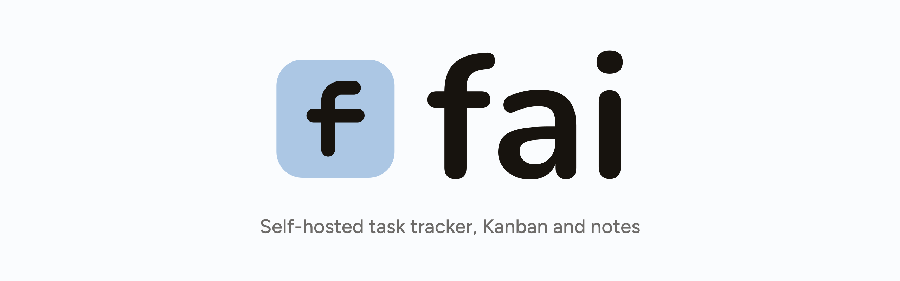

<p align="center">
  
</p>

<p align="center">
  <a href="https://github.com/alialjaffer/fai/actions/workflows/ci.yml"></a>
</p>

# fai

Self-hosted personal task tracker / Kanban / notetaking app. Runs as a web app
behind your own identity provider, as a Docker Compose stack, or as a desktop app.

## Local dev

```sh
make dev-db-up      # Postgres via Docker
make migrate-up      # apply schema
cp backend/.env.example backend/.env
make backend-run      # go run ./cmd/api, DISABLE_AUTH=true
make frontend-run      # vite dev, proxies /api to :8080 (VITE_DISABLE_AUTH=true via .env.development)
```

Backend: Go (chi, pgx, sqlc, goose). Frontend: Vite + React SPA.

## Auth

Two modes, selected by `AUTH_MODE`:

- `oidc` (default, used by the kubernetes deployment) — the backend validates bearer
  JWTs itself via go-oidc against the `fai` public client in Keycloak's `homelab`
  realm (`https://kc.alialjaffer.com/realms/homelab`), frontend does PKCE login.
- `proxy-header` (used by the docker-compose deployment) — the backend trusts an
  `X-Forwarded-User` header set by Caddy after it validates HTTP Basic auth, instead
  of validating a token itself. Only safe when the backend is unreachable except
  through that proxy (enforced by docker-compose's network: the backend's port is
  never published to the host).

`DISABLE_AUTH`/`VITE_DISABLE_AUTH` bypass auth entirely for local dev only — never set
either in a real deployment; the backend fails closed (refuses to start) if auth is
enabled without the required config for whichever mode is selected.

## Database

Two engines, selected by `DATABASE_URL`'s scheme:

- `postgres://...` (kubernetes deployment) — standard Postgres via CNPG; the backend
  applies pending goose migrations itself on startup.
- `sqlite://path/to/file.db` (docker-compose deployment) — a single SQLite file; the
  backend applies its schema itself on first run.

Both are driven through the same `internal/store.Store` interface, so the API behaves
identically regardless of which one is active — see `internal/store/pg` and
`internal/store/lite`.

## Attachments

Tasks and notes accept file attachments (25 MiB each) over
`POST /api/tasks/{id}/attachments` and `POST /api/notes/{id}/attachments`; metadata
lives in the database, bytes live under `ATTACHMENTS_DIR`. The kubernetes deployment
mounts a Longhorn `ReadWriteMany` PVC at `/data/attachments`; docker-compose uses
`/data/attachments` inside the existing `faidata` volume. Leave `ATTACHMENTS_DIR`
unset to disable uploads. Total attachment storage is capped at 10 GiB; uploads are
refused once it is full.

## Calendar subscription

`GET /api/calendar.ics?token=<ICS_TOKEN>` is a read-only ICS feed of open tasks with
a due date, suitable for Apple Calendar (File → New Calendar Subscription). It contains
Fai tasks only; calendars imported into the web calendar are never exported. The Calendar
page lets you add external iCalendar feeds, picks a color per feed, and expands recurring
events for the visible range. It sits
outside OIDC because calendar clients cannot log in, so the token is the credential;
the Settings page shows the full URL. Set `ICS_TOKEN` (`openssl rand -hex 32`) and
`PUBLIC_URL` (used for the task links inside events); rotating the token invalidates
existing subscriptions. In docker-compose, Caddy routes this one path around
`forward_auth`.

## Navigation

`⌘K`/`Ctrl+K` opens the command palette (pages, tasks, new task). `n` opens the inline task composer,
`e` focuses the open task's title, and `Esc` closes sheets/dialogs. The List page
filters by text, column, and tag; rows open the task sheet. Checkboxes support bulk
actions — move to a column, set priority, add or remove labels, set or clear the due
date, mark done/reopen, and delete — with shift-click range selection and select-all.
Subtasks appear under their parent task with a progress count and an expand control. The
Calendar page has a meeting summary button that saves notes and can turn action items
into tasks. Chat is a separate page backed by a fixed Fai system prompt. The nav has a
persisted dark/light theme toggle.

## Notifications

Reminders and meeting-outcome prompts go out over every configured channel; both are
optional, and the scheduler no-ops when neither is set. If one channel fails while the
other delivers, the item is marked sent so the working channel is not re-notified every
minute.

- **ntfy** — `NTFY_URL`, `NTFY_TOPIC`, `NTFY_USERNAME`, `NTFY_PASSWORD`. The
  kubernetes deployment publishes to the in-cluster `ntfy` Service.
- **Email** — `SMTP_ADDR`, `SMTP_FROM`, `SMTP_TO` (comma-separated recipients). The
  kubernetes deployment points at the cluster's rate-limited
  `smtp-relay.mail.svc.cluster.local:587`, which accepts unauthenticated mail from
  allowed namespaces and handles the upstream provider's credentials; fai itself holds
  no SMTP credentials.

## AI

`AI_API_KEY` enables the optional task breakdown, note-to-task plans, meeting extraction,
and chat features; `AI_PROVIDER=opencode-zen`
talks to OpenCode Zen's OpenAI-compatible endpoint with `AI_MODEL` (for example
`claude-haiku-4-5`), while any other value uses Anthropic's Messages API. The endpoints
are rate-limited per authenticated subject. Unset means the UI hides the AI actions.

## Jira

`JIRA_BASE_URL`, `JIRA_EMAIL`, `JIRA_API_TOKEN` enable the bridge.
`JIRA_DEFAULT_PROJECT_KEY` is used when an import omits JQL and an export omits a
project key; `JIRA_STATUS_COLUMN_MAP` is a comma-separated `Jira Status:Board Column`
list applied on import (unmapped statuses fall into the board's first column). Jira
Cloud's `/rest/api/3/search/jql` endpoint is required — the older `/rest/api/3/search`
returns `410 Gone`.

## Docker Compose deployment

A complete non-Kubernetes alternative: SQLite (no separate database container),
bundled ntfy, and Caddy for HTTP Basic auth and TLS. Prerequisites are just Docker
and Docker Compose -- no identity provider or extra auth service.

**Frontend image note:** `VITE_OIDC_AUTHORITY` is baked into the frontend bundle at
*build* time (Vite inlines `VITE_*` vars), so the published
`ghcr.io/alialjaffer/fai-backend`/`fai-frontend:latest` images — built with that
authority set for the kubernetes deployment — aren't quite right for compose: here,
Caddy gates every request (including the initial page load) with Basic auth before
the browser ever reaches the SPA, so the frontend must do *no* client-side OIDC of
its own (a baked-in authority would make it try its own login). CI therefore also
publishes `ghcr.io/alialjaffer/fai-frontend:compose` with that build arg omitted, and
the compose file uses it; `make build-frontend-compose` rebuilds it locally if
needed.

Then:

```sh
cp .env.prod.example .env.prod   # fill in FAI_DOMAIN, FAI_AUTH_USER, FAI_AUTH_HASH
make hash-password               # prompts, prints the bcrypt hash for FAI_AUTH_HASH
docker compose -f docker-compose.prod.yml --env-file .env.prod up -d
```

`--env-file .env.prod` is required (not just `env_file:` inside the compose file) so
the `${FAI_DOMAIN}` used for Caddy's site address and `PUBLIC_URL` resolves — compose
only auto-loads a file literally named `.env` otherwise. The browser gets a native
Basic auth prompt; credentials are cached for the origin and sent on the SPA's API
calls. Caddy sets `X-Forwarded-User` for `/api`, which the backend trusts in
`proxy-header` mode while remaining unpublished outside the compose network. The
`/api/calendar.ics` feed deliberately bypasses Basic auth because calendar clients
use its URL token instead.

## Desktop app (Electron)

The desktop build is a single installable app for macOS, Windows, and Linux. It
bundles the same backend binary and frontend, stores everything in one SQLite file
under the OS's application-data directory, listens on a random loopback port, and
runs with authentication off (there is no network exposure). Attachments live in an
`attachments/` directory next to the database.

```sh
make electron-dev    # build frontend + backend, then run the Electron shell
make electron-dist   # build a local installer for the current OS
```

Data locations:

- macOS: `~/Library/Application Support/fai/`
- Windows: `%APPDATA%\fai\`
- Linux: `~/.config/fai/`

`fai.db` and `attachments/` are created there on first launch; `backend.log` records
the embedded server's output. The desktop app reads optional integrations from the
process environment, or from a `.env` file placed in that data directory (the backend
loads `.env` from its working directory). Core settings such as `DATABASE_URL`,
`BIND_ADDR`, `PORT`, and `DISABLE_AUTH` are fixed by the app.

### Releases

`.github/workflows/release.yml` runs on any `v*` tag and builds macOS arm64, macOS
x64, Linux x64, and Windows x64 artifacts, attaches them to the GitHub release, and
publishes the cask. The macOS app is ad-hoc signed but not notarized. Homebrew does
not add the quarantine attribute, so cask installs launch normally; a DMG downloaded
in a browser needs right-click Open the first time. Windows may show a SmartScreen
warning.

### Homebrew

```sh
brew install --cask alialjaffer/tap/fai
```

The release workflow pushes `Casks/fai.rb` to `aliAljaffer/homebrew-tap` over SSH,
using the private half of a read/write deploy key stored as the `TAP_DEPLOY_KEY`
repository secret. Linux users install the `tar.gz` or `AppImage` from the release
page instead; Homebrew casks are macOS-only.

## License

MIT. See `LICENSE`.
