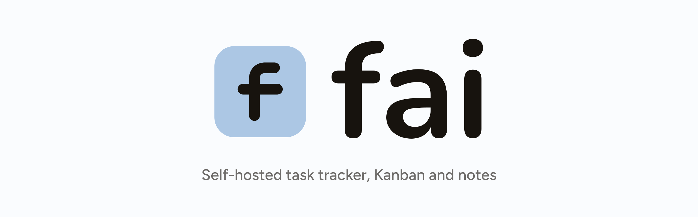
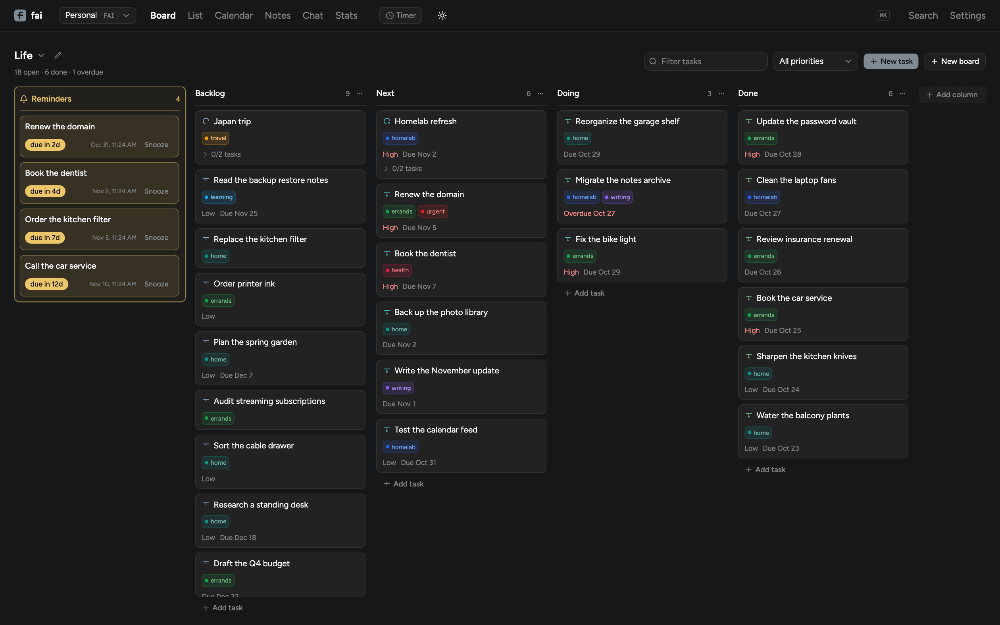
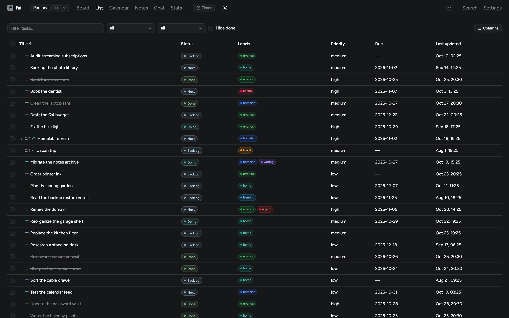
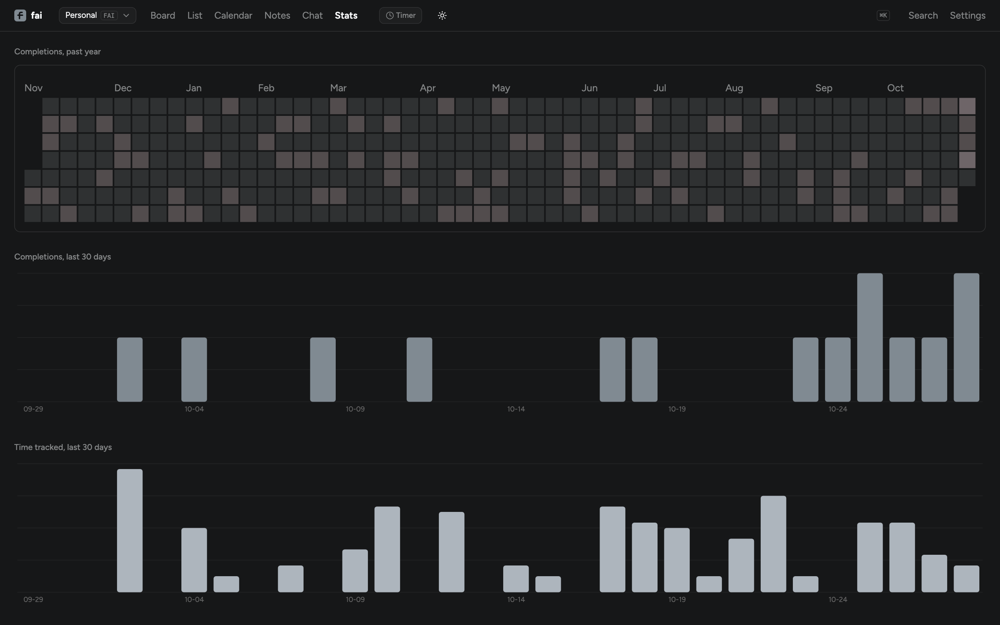
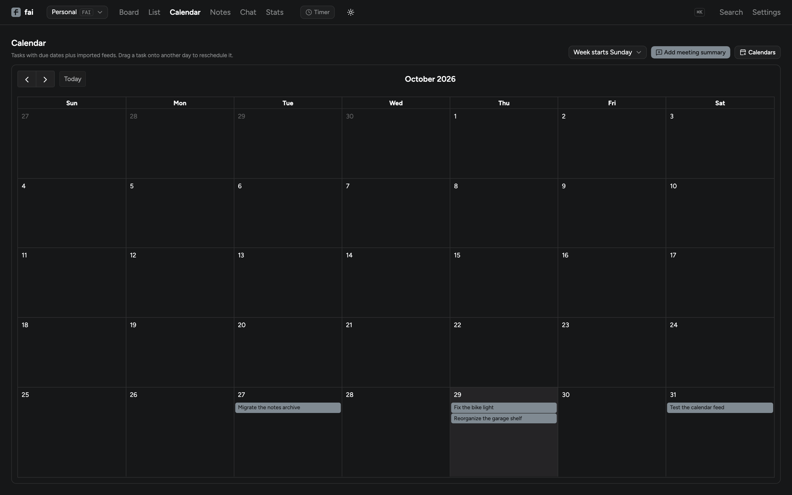

<p align="center">
  
</p>

<p align="center">
  <a href="https://github.com/alialjaffer/fai/actions/workflows/ci.yml"></a>
</p>

# fai

Self-hosted workspace for tasks, notes, reminders, and calendars. Run it as a
web app, Docker Compose stack, or desktop app.

Features include task boards and lists, Markdown notes, calendars, time
tracking, reminders, Jira, optional AI, and themes. See the
[installation guide](docs/INSTALLATION_GUIDE.md) for feature details and setup.

## Quick start

### Docker, local

```sh
make up
```

Open <http://localhost:8080>. No configuration is needed. The stack builds from
this checkout, uses SQLite, and keeps data in Docker volumes. `make down` stops
it. `make up` rebuilds after code changes.

### Docker, production

```sh
cp .env.example .env
# Set FAI_DOMAIN and FAI_AUTH_PASSWORD in .env.
make up-prod
```

Point DNS at the server before you start. Caddy gets the TLS certificate and
asks for the Basic auth password. `make down-prod` stops the stack. Every other
value in `.env` is optional.

Requirements: Docker and Make.

### Homebrew

```sh
brew install --cask alialjaffer/tap/fai
```

Then disable Apple quarantine on the application:

```sh
xattr -d com.apple.quarantine /Applications/fai.app
```

More information regarding MacOS Quarantine: [How to Install a Quarantined Application on macOS Using Terminal](https://support.fotomaster.com/articles/how-to-install-a-quarantined-application-on-macos-using-terminal)

### Desktop

Download an installer from the [latest release](https://github.com/alialjaffer/fai/releases/latest). To build locally:

```sh
make electron-dist
```

### Develop

```sh
make backend-run
make frontend-run
```

Open <http://localhost:5173>. Requirements: Go 1.27 and Node 22. The backend
defaults to SQLite at `backend/data/fai.db` with authentication off, and the
Vite dev server proxies `/api` to it. To use PostgreSQL instead, run
`make dev-db-up` and set `DATABASE_URL` in `backend/.env`.

See the [installation guide](docs/INSTALLATION_GUIDE.md) for full setup,
configuration, and integrations.

## Screenshots

All screenshots use synthetic tasks, notes, and labels.

| Board | List |
|:---:|:---:|
|  |  |

| Stats | Calendar |
|:---:|:---:|
|  |  |

## Stack

Go, React, Vite, Electron, SQLite, and PostgreSQL.

## Links

- [Installation guide](docs/INSTALLATION_GUIDE.md)
- [Agent integration](docs/AGENT_INTEGRATION.md)
- [Security policy](SECURITY.md)
- [License](LICENSE)
