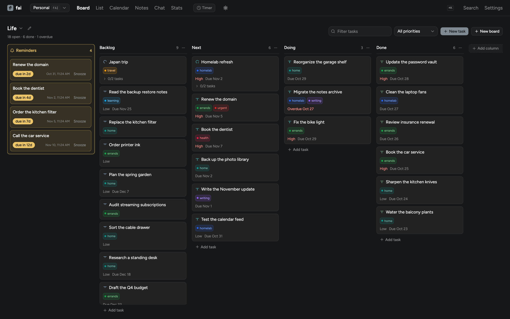
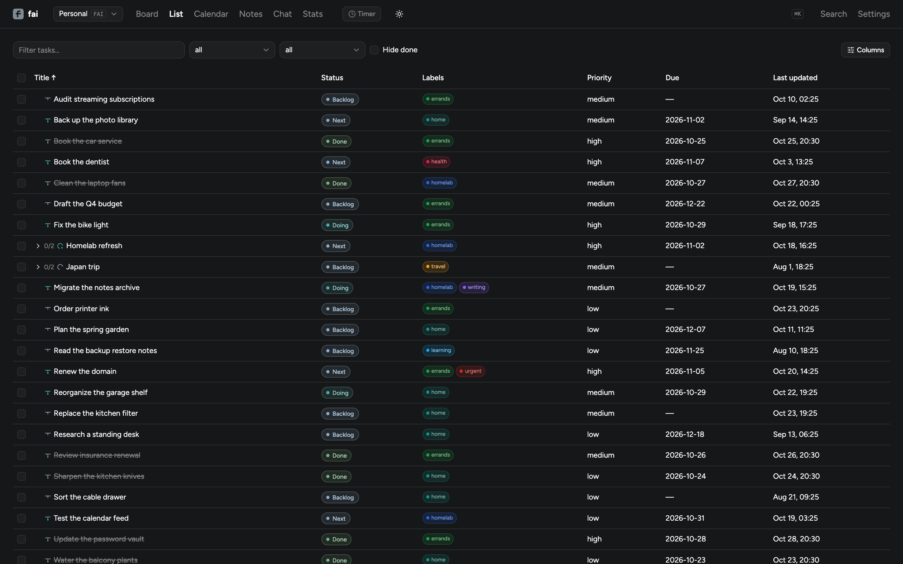
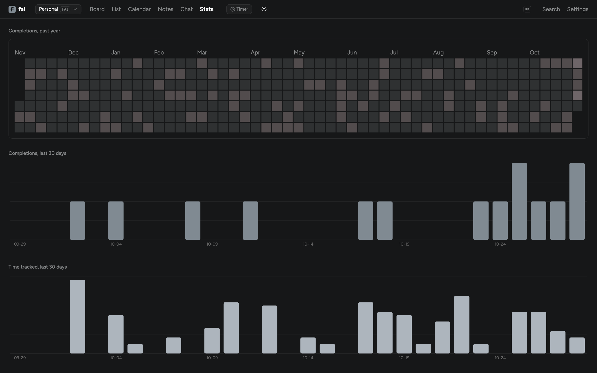
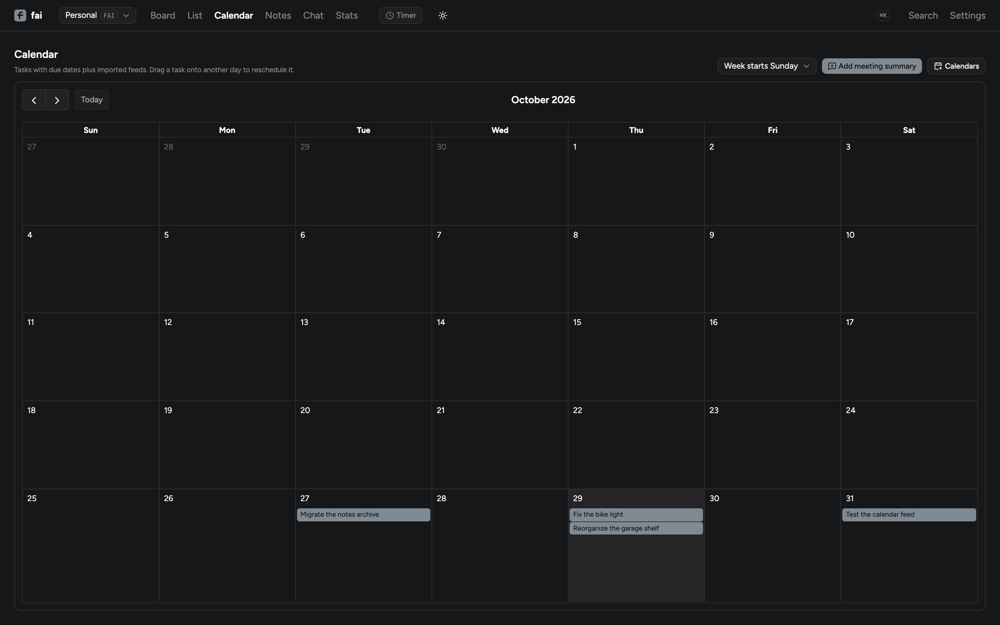

<p align="center">
  
</p>

<p align="center">
  <a href="https://github.com/alialjaffer/fai/actions/workflows/ci.yml"></a>
</p>

# fai

Self-hosted personal task tracker / Kanban / notetaking app. Runs as a web app
behind your own identity provider, as a Docker Compose stack, or as a desktop app.

## What it does

fai keeps tasks, notes, reminders, and your calendar in one place. The data is
yours, and nobody else needs an account.

- **Board and list.** Drag tasks between columns, or work from the list with
  sorting, filters, and bulk actions.
- **Workspaces.** Separate boards, notes, reminders, and calendars. Every task
  gets a reference like `FAI-42`, so you can point at it from notes, reminders,
  or chat.
- **Task types.** Arcs group work, tasks are the work, and steps break it down.
  Tasks also get subtasks, labels, priorities, due dates, comments, and file
  attachments.
- **Time tracking.** Start a timer from the task sheet or the nav. Totals show
  on the task and in Stats.
- **Notes.** Markdown notes with `[[wikilinks]]`, backlinks, and attachments.
  A note can become a task plan with AI.
- **Calendar.** Import iCalendar feeds, pick a color per feed, and expand
  recurring events. Write a meeting summary, then turn the action items into
  tasks.
- **Search and stats.** Search tasks and notes, see a completion heatmap, and
  chart time tracked over the last month.
- **Reminders and notifications.** The board has a reminders column, and
  reminders can also go out over ntfy or email.
- **Optional AI.** Ask for a task breakdown, label suggestions, a note plan,
  meeting extraction, or chat. Everything stays hidden until you add a key.
- **Jira bridge.** Import issues with JQL, export tasks, and map Jira statuses
  to board columns.
- **Themes.** Dozens of palettes, a custom palette, and per-workspace colors.

## Screenshots

All screenshots use synthetic tasks, notes, and labels.

| Board | List |
|:---:|:---:|
|  |  |

| Stats | Calendar |
|:---:|:---:|
|  |  |

## Requirements

Go 1.27, Node 22, Docker, and either SQLite or PostgreSQL. Schema changes also
need `goose` and `sqlc`. A Keycloak issuer is optional for local development and
required for the OIDC mode.

## Quick start

```sh
make dev-db-up      # Postgres in Docker
make migrate-up     # apply the schema
cp backend/.env.example backend/.env
make backend-run    # go run ./cmd/api with DISABLE_AUTH=true
make frontend-run   # Vite dev server, proxies /api to :8080
```

Backend: Go with chi, pgx, sqlc, and goose. Frontend: Vite and a React SPA.

## Deployment

### Docker Compose

This is the full stack without Kubernetes: SQLite, a bundled ntfy container,
and Caddy for Basic auth and TLS. You need Docker and Docker Compose only. There
is no identity provider to configure.

```sh
cp .env.prod.example .env.prod   # fill in FAI_DOMAIN, FAI_AUTH_USER, FAI_AUTH_HASH
make hash-password               # prompts and prints the bcrypt hash for FAI_AUTH_HASH
docker compose -f docker-compose.prod.yml --env-file .env.prod up -d
```

Pass `--env-file .env.prod` on the command line, not only through `env_file:`
inside the Compose file. Compose otherwise auto-loads only a file named `.env`,
and `${FAI_DOMAIN}` and `PUBLIC_URL` will not resolve.

The browser gets a native Basic auth prompt. Caddy sets `X-Forwarded-User` for
`/api`, and the backend trusts it in `proxy-header` mode while staying
unpublished outside the Compose network. The ICS feed bypasses Basic auth
because calendar clients use its URL token instead.

**Build note:** Vite inlines `VITE_*` variables at build time, so
`VITE_OIDC_AUTHORITY` is baked into the frontend bundle. The published images
are built for the Kubernetes deployment and carry that authority. Compose needs
a frontend that does no client-side OIDC of its own, because Caddy already gates
every request. CI publishes `ghcr.io/alialjaffer/fai-frontend:compose` with the
build arg omitted, and the Compose file uses it. Run `make build-frontend-compose`
to rebuild it locally.

### Desktop app

The Electron build is one installable app for macOS, Windows, and Linux. It
bundles the same backend and frontend, stores everything in a single SQLite
file in the OS application-data directory, listens on a random loopback port,
and runs with auth off because nothing is exposed to the network. Attachments
live in an `attachments/` directory next to the database.

```sh
make electron-dev    # build the frontend and backend, then start Electron
make electron-dist   # build an installer for the current OS
```

Data locations:

- macOS: `~/Library/Application Support/fai/`
- Windows: `%APPDATA%\fai\`
- Linux: `~/.config/fai/`

`fai.db`, `attachments/`, and `backend.log` appear there on first launch. The
desktop app reads optional integrations from the process environment or from a
`.env` file in that directory. Core settings such as `DATABASE_URL`,
`BIND_ADDR`, `PORT`, and `DISABLE_AUTH` are fixed by the app.

### Releases

The release workflow runs on any `v*` tag. It builds macOS arm64, macOS x64,
Linux x64, and Windows x64 artifacts, attaches them to the GitHub release, and
publishes the Homebrew cask. The macOS app is ad-hoc signed but not notarized.
Homebrew installs skip the quarantine attribute, so the cask launches normally.
A DMG downloaded in a browser needs a right-click Open the first time. Windows
may show a SmartScreen warning.

Installed copies check GitHub Releases every six hours and show an update badge
in the nav. Downloads wait for you by default. Settings has a toggle for
automatic downloads, the current version, and a manual check button.

### Homebrew

```sh
brew install --cask alialjaffer/tap/fai
```

Linux users can install the `tar.gz` or `AppImage` from the release page.
Homebrew casks are macOS-only.

## Configuration

### Auth

Set `AUTH_MODE` to choose how fai trusts a user:

- `oidc` (the default) checks bearer JWTs against the `fai` client in the
  `homelab` Keycloak realm. The frontend does a PKCE login.
- `proxy-header` trusts an `X-Forwarded-User` header set by Caddy after Caddy
  validates HTTP Basic auth. This is safe only when the backend cannot be
  reached except through that proxy. The Docker Compose stack enforces this by
  never publishing the backend port.

`DISABLE_AUTH` and `VITE_DISABLE_AUTH` bypass auth for local development. Never
set either one in a real deployment. If auth is enabled without the config for
the selected mode, the backend refuses to start.

### Database

Set `DATABASE_URL` to pick the engine:

- `postgres://...` uses Postgres. The backend applies pending goose migrations
  itself on startup.
- `sqlite://path/to/file.db` uses a single SQLite file. The backend creates the
  schema on first run.

Both engines sit behind the same `internal/store.Store` interface, so the API
behaves the same either way. See `internal/store/pg` and `internal/store/lite`.

### Attachments

Tasks and notes accept files up to 25 MiB through
`POST /api/tasks/{id}/attachments` and `POST /api/notes/{id}/attachments`.
Metadata lives in the database and the bytes live under `ATTACHMENTS_DIR`.
Uploads stop working when you leave `ATTACHMENTS_DIR` unset, or when storage
reaches 10 GiB.

### Calendar feed

Subscribe to `GET /api/calendar.ics?token=<ICS_TOKEN>` from Apple Calendar
(File, New Calendar Subscription) or any other ICS client. The feed is
read-only and contains open tasks with a due date. It never includes calendars
imported into the web app.

Calendar clients cannot log in, so the token is the credential. Set `ICS_TOKEN`
(for example with `openssl rand -hex 32`) and `PUBLIC_URL`, which is used for
the task links inside events. Changing the token breaks existing subscriptions.
In Docker Compose, Caddy routes this one path around Basic auth.

### Notifications

Reminders and meeting-outcome prompts go out over every configured channel.
Both channels are optional. With neither configured, the scheduler does nothing.
If one channel fails and the other delivers, fai marks the item sent so the
working channel is not notified again every minute.

- **ntfy:** `NTFY_URL`, `NTFY_TOPIC`, `NTFY_USERNAME`, and `NTFY_PASSWORD`.
- **Email:** `SMTP_ADDR`, `SMTP_FROM`, and `SMTP_TO` (comma-separated
  recipients).

### AI

Set `AI_API_KEY` to turn on task breakdown, note plans, meeting extraction, and
chat. `AI_PROVIDER` accepts `anthropic`, `openai`, or `openai-compat` (also
called `opencode-zen`). `AI_MODEL` names the model, and `AI_BASE_URL` points at
any OpenAI-compatible endpoint.

You can also set the provider, model, base URL, and key in Settings. Values
saved there live in the database and override the environment. AI endpoints are
rate-limited per user. With no key in either place, the UI hides every AI
action.

Set `ELEVENLABS_API_KEY` to transcribe voice notes with ElevenLabs instead of
the chat provider. `ELEVENLABS_STT_MODEL` defaults to `scribe_v2`. The key needs
the `speech_to_text` permission.

### Telegram assistant

The Telegram assistant reuses the web chat actions: create tasks and reminders,
find tasks, and move a task to another column after a confirmation. It runs
inside the API binary and needs an AI key because the model chooses the action.

It allows one owner. Set the allowlist or the assistant stays off. Only private
chats are accepted. Voice notes are transcribed, echoed back as text, and then
handled like a typed message. ElevenLabs handles transcription when
`ELEVENLABS_API_KEY` is set; otherwise the chat provider must accept audio, which
rules out Anthropic. If a transcription request rejects Telegram's OGG/Opus, the
backend converts the note to mono MP3 with the ffmpeg binary bundled in the
image and retries. The last 10 messages per chat live in memory and
are lost on restart. Message IDs are remembered for 10 minutes, so a transport
retry does not create a task twice.

Telegram uses `getUpdates` long polling, so it needs no public route:

- `TELEGRAM_BOT_TOKEN`
- `TELEGRAM_ALLOWED_USER_ID`
- `TELEGRAM_ALLOWED_CHAT_ID`
- `TELEGRAM_STATE_FILE` (optional, defaults to `fai-telegram-offset`)

### Jira

Set `JIRA_BASE_URL`, `JIRA_EMAIL`, and `JIRA_API_TOKEN` to enable the bridge.
`JIRA_DEFAULT_PROJECT_KEY` is used when an import has no JQL and an export has
no project key. `JIRA_STATUS_COLUMN_MAP` is a comma-separated
`Jira Status:Board Column` list. Unmapped statuses land in the board's first
column.

Jira Cloud's `/rest/api/3/search/jql` endpoint is required. The older
`/rest/api/3/search` endpoint returns `410 Gone`.

Issue types map one way each: Jira Epic to Arc, Sub-task to Step, and every
other type (including Story and Bug) to Task. On export, `JIRA_EPIC_ISSUE_TYPE`
(default `Epic`), `JIRA_TASK_ISSUE_TYPE` (default `Task`), and
`JIRA_SUBTASK_ISSUE_TYPE` (default `Sub-task`) name the target types.
`JIRA_EPIC_LINK_FIELD` (default `parent`) attaches a task to its arc. On
company-managed projects, set it to `customfield_10014` or the field id your
project uses.

## Development

Run the checks CI runs:

```sh
cd backend && go vet ./... && go test ./... && go build ./...
cd frontend && npm run lint && npm run build
```

## Layout

| Path | Contents |
|---|---|
| `backend/` | Go API, store, migrations, and integrations |
| `frontend/` | Vite and React SPA |
| `electron/` | Desktop shell and packaging |
| `brand/` | README art and palette previews |
| `.github/` | CI and release workflows |

## Privacy

fai stores everything in your database and attachments directory. It has no
telemetry. Optional AI calls send the text you trigger to the provider you
configure, with your key. Jira and calendar integrations talk only to the
servers you name.

## License

MIT. See `LICENSE`.
